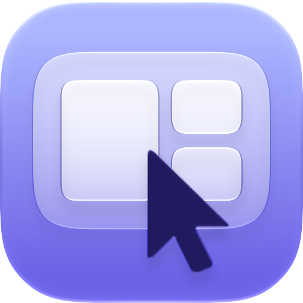
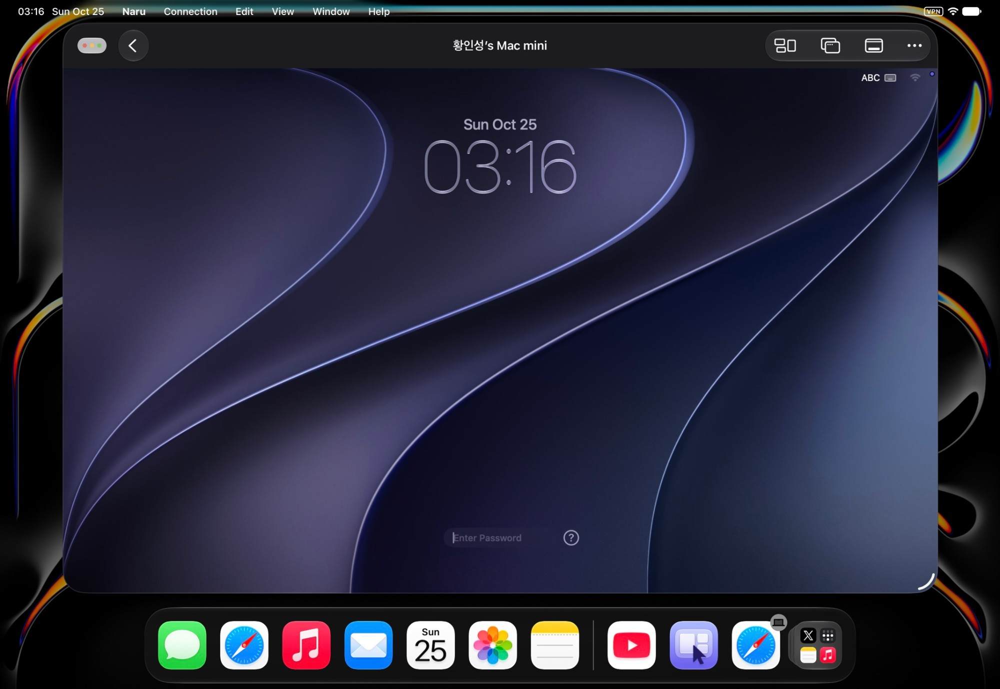

  
  <h1>Naru</h1>
  
Use your Mac's built-in Screen Sharing from an iPad, an Android tablet, or a Windows PC.

  

    &nbsp;&nbsp;
    &nbsp;&nbsp;
    
  

  

## Features

- **Nothing to install on the Mac.** Naru connects to the Screen Sharing that comes with macOS, in its High Performance
  mode, as Apple's own Screen Sharing app does.
- **Sharp, smooth picture.** The Mac's screen arrives in full color at up to 60 frames per second, with its sound.
- **A display of its own.** Naru can give the Mac a virtual display shaped like your screen, or show the Mac's own
  display.
- **Your keyboard, your language.** With Sync Keyboard Language on, the Mac's input source follows the one you type
  in: the Korean/English key on a Windows PC, or the Globe key on an iPad, switches the Mac as well.
- **Shared clipboard.** Copy on one side and paste on the other: text everywhere, and images on iPad and Windows.
- **Trackpad gestures.** Scrolling with momentum and pinch to zoom behave as on a Mac, and touch works as a trackpad.

## Requirements

- A Mac with Apple silicon on macOS Sonoma 14 or later, with **Screen Sharing** turned on in System Settings >
  General > Sharing
- An iPad on iPadOS 26 or later, a tablet on Android 10 or later, or a PC on Windows 11

## Getting started

1. On the Mac, turn on Screen Sharing in System Settings > General > Sharing.
2. In Naru, add the Mac by its name or IP address. Macs on the same network also appear on their own.
3. Sign in with a user account on that Mac.

## Tips

> [!WARNING]
> **Never open a port on your router for Screen Sharing.** A Screen Sharing port open to the internet invites password
> guessing against your Mac. To connect from outside your home, use a VPN instead: your router's WireGuard server, or
> [Tailscale](https://tailscale.com) on the Mac and on the device you connect from.

**Fewer stutters on Wi-Fi.** Apple devices nearby periodically leave your Wi-Fi channel to listen for AirDrop and other
Continuity features, which pauses the picture about every half second. On your router, set the 5 GHz band to channel
149 (or 44 where 149 is not available) with a width of 80 MHz rather than 160 MHz, and the 2.4 GHz band to channel 6.
Apple devices listen on those channels, so they no longer need to leave yours.

**Clipboard on iPad.** To share the clipboard without iPadOS asking each time, go to Settings > Apps > Naru and set
**Paste from Other Apps** to **Allow**.

## Privacy

Naru collects nothing and talks only to your Mac. See the [privacy policy](PRIVACY.md).

## Contributing

See [CONTRIBUTING.md](CONTRIBUTING.md) for setting up and building, and [docs/architecture.md](docs/architecture.md)
for how the apps and their shared Rust core fit together.

## License

Naru is available under the [MIT License](LICENSE). It is not affiliated with or endorsed by Apple. Mac, iPad, macOS,
and iPadOS are trademarks of Apple Inc.
